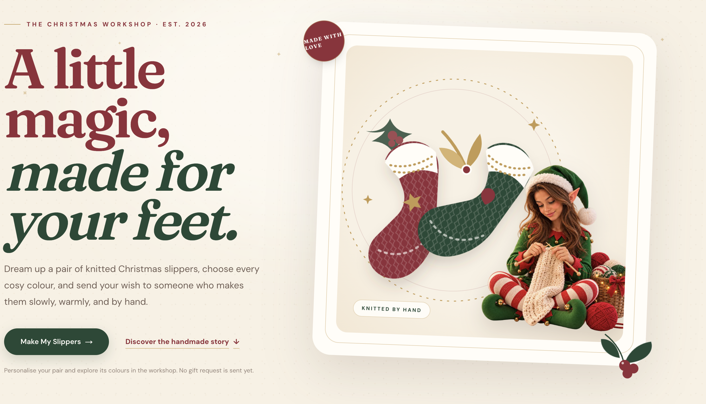
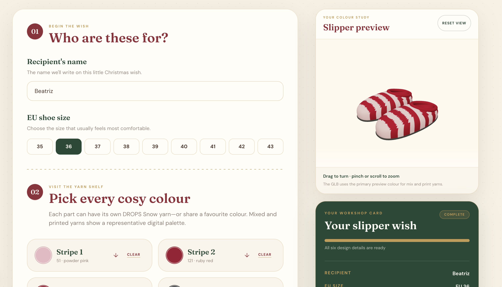
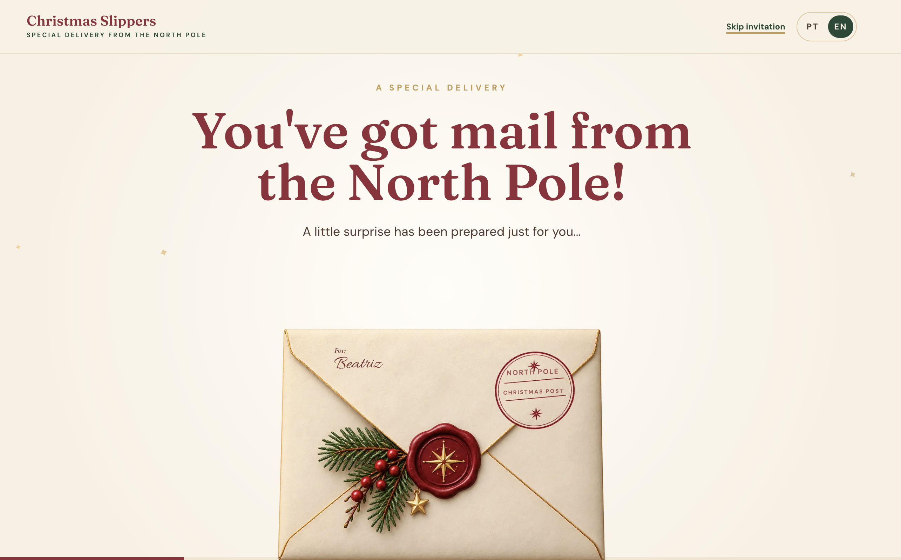
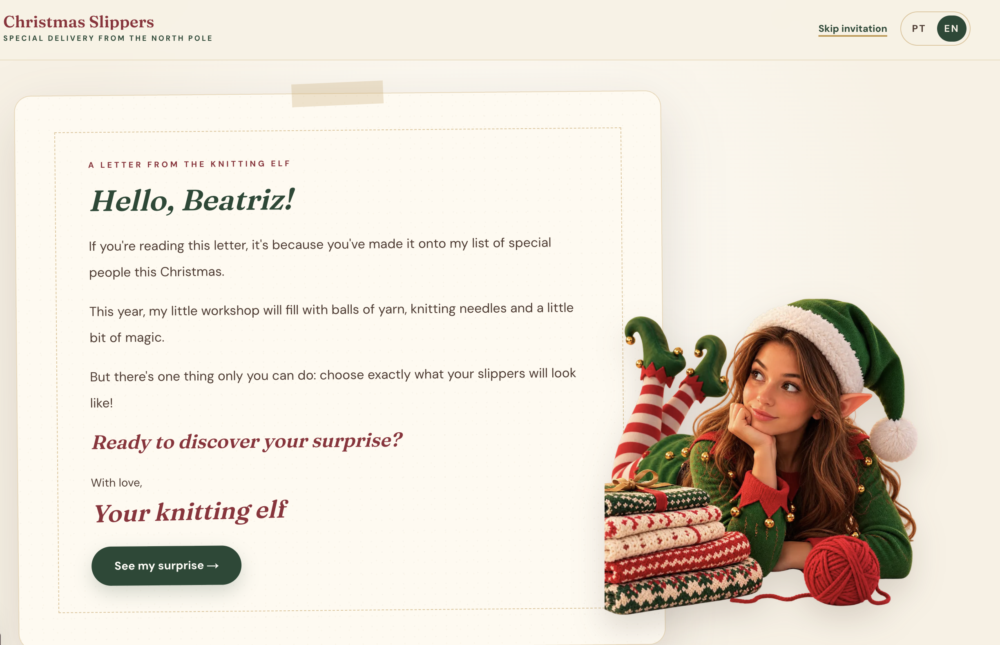
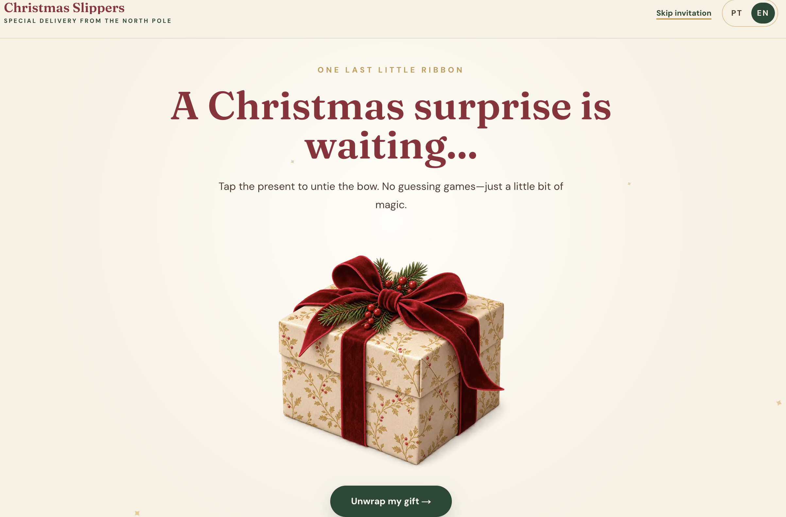
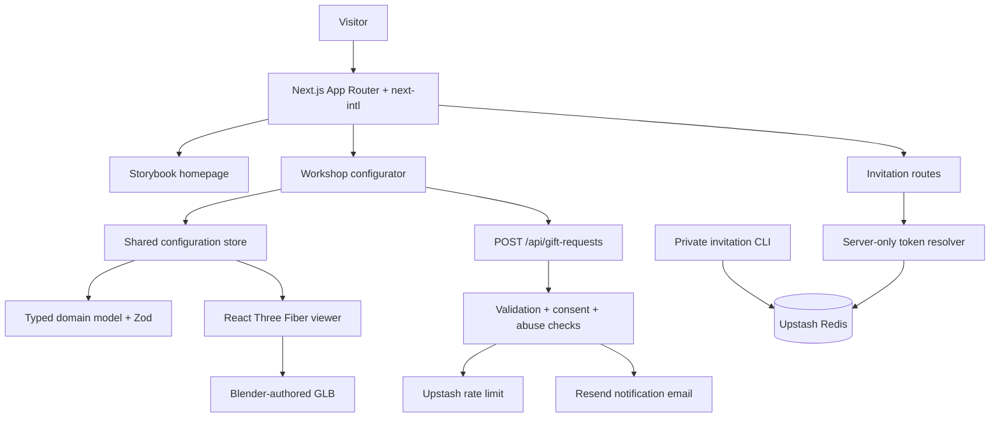

# Christmas Slippers

> A little Christmas magic, one handmade pair at a time.

Christmas Slippers is a bilingual, interactive gifting experience where friends can design a pair of handmade knitted slippers, explore the result in 3D, and send a private Christmas wish. Specially invited guests can begin with a personalised, story-led journey from a sealed North Pole envelope to the workshop.

**Built with:** Next.js 16 · React 19 · TypeScript · Tailwind CSS 4 · React Three Fiber · Three.js · next-intl · Zod · Resend · Upstash Redis



## The Experience

The public website opens as a nostalgic Christmas storybook in Portuguese or English. From there, a visitor can:

1. Enter the workshop and choose a recipient, EU shoe size, and four independent yarn colours.
2. Search 87 documented DROPS Snow colourways and apply them to the slipper stripes, collar, and sole.
3. Rotate and zoom a GLB pair of Sailor Slippers while selections update its named material regions.
4. Review the complete design, then optionally submit a private gift request by email.

A separate bearer-link invitation flow adds a sealed envelope, personalised elf letter, gift reveal, and locale-preserving route into the same workshop. Invitations never appear automatically on the ordinary homepage.

### Workshop and invitation



<p align="center">
  
  
  
</p>

> The invitation screenshots use the fictional name “Noelle”. No real recipient record or usable invitation token is stored in this repository.

## Features

- **Bilingual routes:** European Portuguese and English content, validation, accessibility labels, invitations, workshop, and notification email copy.
- **Typed slipper configuration:** a React-independent domain model for recipient name, supported EU sizes 35–43, and four reusable yarn colour zones.
- **Real yarn catalogue:** 87 retailer-listed DROPS Snow colourways with manufacturer IDs, names, approximate preview colours, representative palettes, source dates, and stock metadata.
- **Accessible yarn picker:** searchable by colour number or name, keyboard navigable, touch friendly, and able to show mixed or printed colour palettes.
- **Interactive 3D preview:** a Blender-authored GLB pair rendered with React Three Fiber and mapped to `stripe1`, `stripe2`, `ankle`, and `sole` material tokens.
- **Private gift requests:** server-side Zod validation, international WhatsApp normalisation, explicit contact consent, abuse controls, and HTML/plain-text Resend notifications.
- **Personalised invitations:** securely generated bearer links, server-side recipient lookup, generic invitations, expiration and revocation, and legacy-link compatibility.
- **Inclusive presentation:** semantic controls, visible focus states, WebGL fallback messaging, reduced-motion support, responsive layouts, and no invitation-only dependency for the main experience.

## Architecture



The browser owns one lightweight configuration draft, so the form, summary, and 3D viewer consume the same state without a global state dependency. Domain types and schemas remain independent of React, browser APIs, and Three.js. Server-only boundaries isolate contact details, email delivery, rate limiting, and invitation records.

## Engineering Highlights

### A maintainable model pipeline

The source slipper pair lives in an editable Blender file with reproducible build and export scripts. The GLB contract uses four stable material tokens—`CS_STRIPE1`, `CS_STRIPE2`, `CS_ANKLE`, and `CS_SOLE`—so the web viewer can recolour cloned materials without coupling the configurator to mesh internals. Texture maps and authored PBR properties remain intact.

The viewer is client-only, uses demand-based rendering and a capped device pixel ratio, and keeps rotation, zoom, reset, loading, reduced-motion, and WebGL fallback behaviour separate from model loading and colour mapping.

### Defensive server workflows

Gift requests are limited to a 16 KB body and parsed through a shared Zod schema. The route trims and validates fields, normalises optional phone numbers to E.164, requires explicit consent, checks a honeypot, escapes email content, and applies a Redis-backed production rate limit before asking Resend to send. Automated tests inject a fake sender and never contact the email provider.

Invitation tokens are 256-bit random bearer values. Redis stores only their SHA-256 lookup hashes alongside private metadata; tokens and recipient records are not committed or exposed by a public creation endpoint. Invitation responses disable public caching and use a no-referrer policy. Creation, listing, and revocation remain deliberate administrator-only CLI operations.

### Accessibility and motion

Interactive artwork remains backed by real buttons and keyboard operation. Decorative layers ignore pointer events and assistive technology. The experience uses semantic form controls, accessible error feedback and focus management, touch-sized targets, deterministic effects, reduced-motion alternatives, and a non-WebGL fallback.

## Getting Started

### Prerequisites

- [Node.js 24](https://nodejs.org/) (pinned in `.nvmrc`)
- npm
- Optional service accounts for Resend and Upstash Redis when testing email submission or private invitations
- Optional Blender installation only when rebuilding the 3D asset

### Install and run

```bash
nvm use
npm ci
cp .env.example .env.local
npm run dev
```

Open [http://localhost:3000](http://localhost:3000). The homepage, workshop, catalogue, and 3D customiser run without external service credentials. Gift-request delivery requires Resend and a durable production rate limit requires Upstash. Invitation creation and resolution require Upstash plus a public base URL.

### Environment variables

Keep these values in the ignored `.env.local` file. Never prefix them with `NEXT_PUBLIC_`.

| Variable | Purpose |
| --- | --- |
| `RESEND_API_KEY` | Server-side Resend authentication |
| `GIFT_REQUEST_FROM_EMAIL` | Sender using a Resend-verified domain |
| `GIFT_REQUEST_TO_EMAIL` | Private workshop notification inbox |
| `UPSTASH_REDIS_REST_URL` | Redis REST endpoint for rate limits and invitations |
| `UPSTASH_REDIS_REST_TOKEN` | Server-only Redis REST token |
| `GIFT_REQUEST_RATE_LIMIT_SECRET` | Secret used to derive privacy-preserving rate-limit keys |
| `INVITATION_PUBLIC_BASE_URL` | Deployed origin used when the CLI generates invitation links |

`.env.example` contains placeholders only.

## Commands

| Command | Purpose |
| --- | --- |
| `npm run dev` | Start the Next.js development server |
| `npm run build` | Create a production build |
| `npm start` | Serve the production build |
| `npm run lint` | Run ESLint |
| `npx tsc --noEmit` | Run strict TypeScript validation |
| `npm test` | Run the Node-based automated test suite |

### Invitation administration

```bash
npm run invite:create -- --name "Mariana"
npm run invite:create -- --name "Mariana" --expires "2026-12-31T23:59:59Z"
npm run invite:create-generic
npm run invite:create-generic -- --expires "2026-12-31T23:59:59Z"
npm run invite:list
npm run invite:revoke -- --token "paste-the-private-token-here"
```

Creation prints Portuguese and English links. Listing intentionally omits bearer tokens; revocation requires the original private token. Never paste a real invitation URL into source code, issues, analytics, screenshots, or chat logs.

Dedicated invitation URLs use `/invite/<token>` in Portuguese and `/en/invite/<token>` in English. Legacy `/invitation-preview?invite=<token>` links remain compatible.

### Rebuild the GLB

After editing the Blender source, export the web asset with:

```bash
/Applications/Blender.app/Contents/MacOS/Blender \
  --background assets/blender/sailor-slippers.blend \
  --python assets/blender/scripts/export_slippers_glb.py
```

The exporter validates orientation, centring, sole height, material tokens, and scene contents before writing `public/models/sailor-slippers.glb`. See [`public/models/README.md`](public/models/README.md) for the asset contract.

## Testing

The automated suite currently contains 66 tests using Node's built-in test runner and the project's TypeScript loader. Coverage focuses on:

- slipper configuration and catalogue validation;
- yarn search and 3D material mapping;
- gift-request parsing, contact normalisation, rate limiting, and email rendering;
- invitation state transitions, token validation, storage, locale-preserving routes, expiration, and revocation.

There is not yet a committed browser end-to-end suite. Responsive, WebGL, keyboard, touch, and physical-device journeys are therefore supplemented by manual acceptance testing.

## Project Structure

```text
src/
├── app/                     # Locale-aware pages and gift-request API route
├── components/
│   ├── configurator/        # Personal details, yarn pickers, shared draft UI
│   ├── gift-request/        # Contact and submission experience
│   ├── invitation/          # Typed invitation scenes and interactions
│   ├── landing/             # Storybook homepage sections
│   └── three/               # GLB loading, mapping, scene, controls, fallback
├── domain/slipper/          # Catalogue, types, defaults, and Zod schema
├── i18n/                    # next-intl routing and request configuration
├── lib/                     # Server workflows, invitations, and rate limits
└── messages/                # Portuguese and English dictionaries

assets/blender/              # Editable .blend source and reproducible scripts
public/images/               # Approved storybook and invitation artwork
public/models/               # Runtime GLB and material contract
scripts/invitations.ts       # Private invitation administrator CLI
tests/                       # Node test suite
```

## Known Limitations and Roadmap

- No public deployment URL is documented or verified yet.
- A submitted wish sends a private notification email; it is not an order, payment, stock guarantee, or promise that slippers will be made.
- Yarn availability is a dated retailer snapshot rather than live inventory. Preview HEX values are documented visual approximations.
- The configuration draft is intentionally local and resets on reload; there is no account or saved-design database.
- Invitation management is CLI-only and requires private Upstash access.
- The GLB is a crafted visual approximation of the reference slippers, not a manufacturing model or exact size simulation.
- Automated browser tests, continuous integration, and production observability are not yet committed.
- Production operators still need a complete privacy notice and documented retention/deletion process for contact data.

## Development Process

This is an AI-assisted personal software project. The project owner defined the product direction, supplied visual references, made design and architecture decisions, reviewed iterative implementations, and performed acceptance testing—including testing on a physical iPhone. AI tools assisted with implementation, research synthesis, debugging, tests, and documentation. Final decisions and review remained with the project owner.

The repository history is organised into focused feature branches and Conventional Commits so the evolution from landing page to typed domain model, 3D pipeline, server workflows, localisation, and invitations remains inspectable.

## Credits and Licensing

- Yarn catalogue data is documented from the [DROPS Snow manufacturer collection](https://www.garnstudio.com/yarn.php?show=drops-snow&cid=19) and the [Laral Crafts retailer listing](https://www.laralcrafts.com/products/drops-snow). Product names and identifiers belong to their respective owners; digital preview colours are approximate.
- The repository includes project-specific artwork and a Blender-authored slipper model informed by supplied Sailor Slippers references. Asset attribution and redistribution permissions should be confirmed before reuse outside this project.
- Fonts are loaded through Next.js from Google Fonts: Fraunces, DM Sans, and Allura.

This repository does **not** currently include a software or asset licence. Source availability alone does not grant permission to copy, modify, or redistribute the code or artwork. Add an explicit licence only after code and asset rights have been reviewed.
